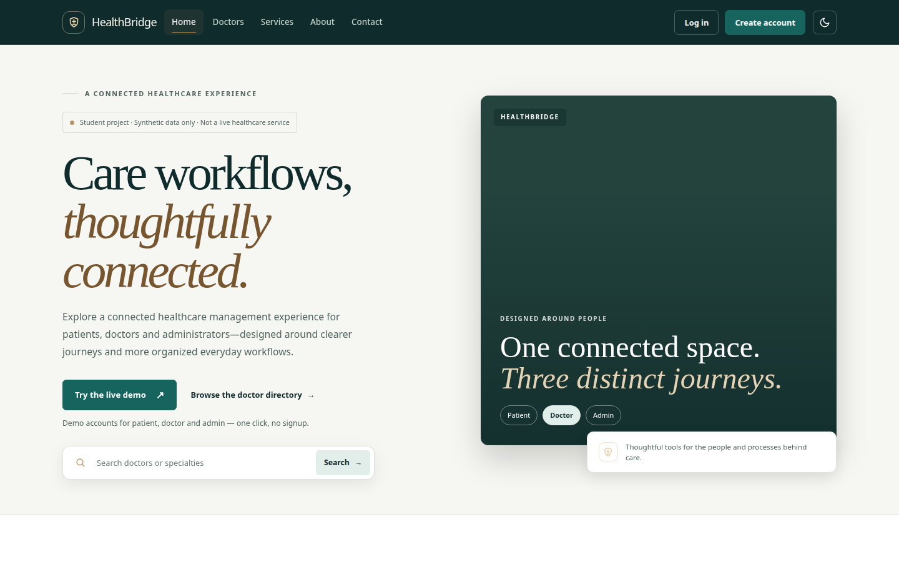
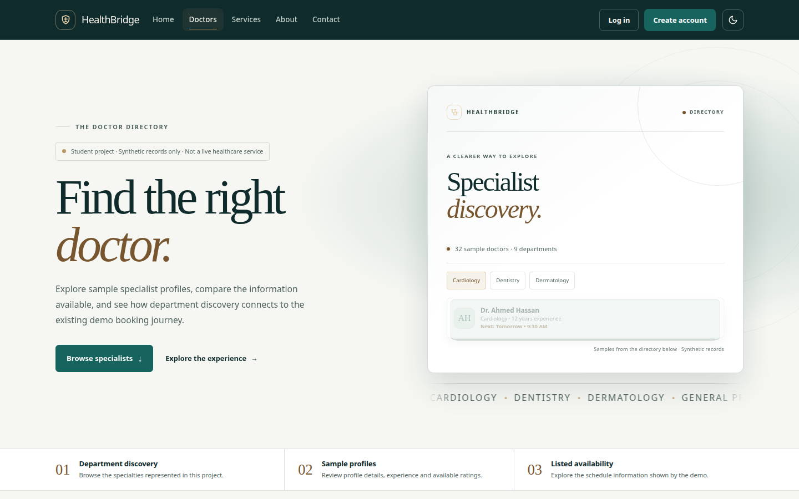
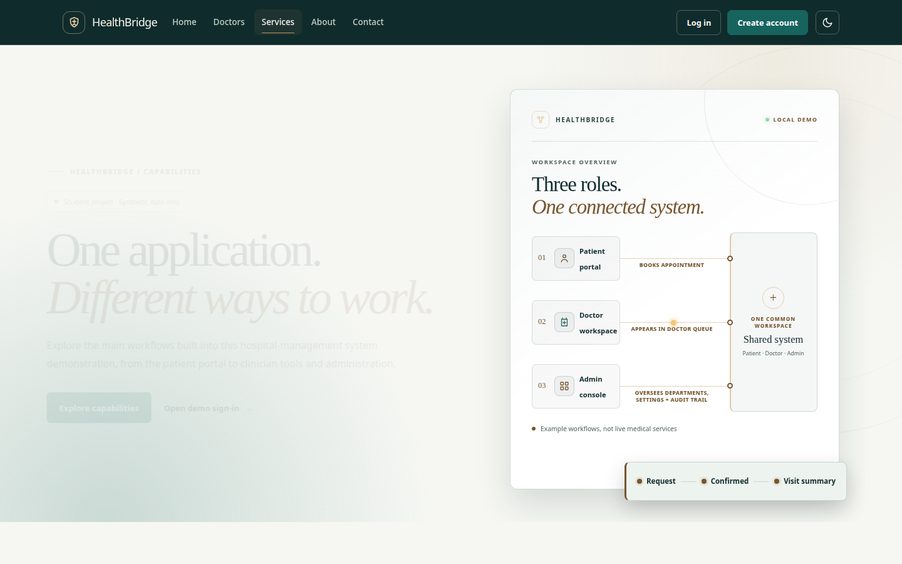
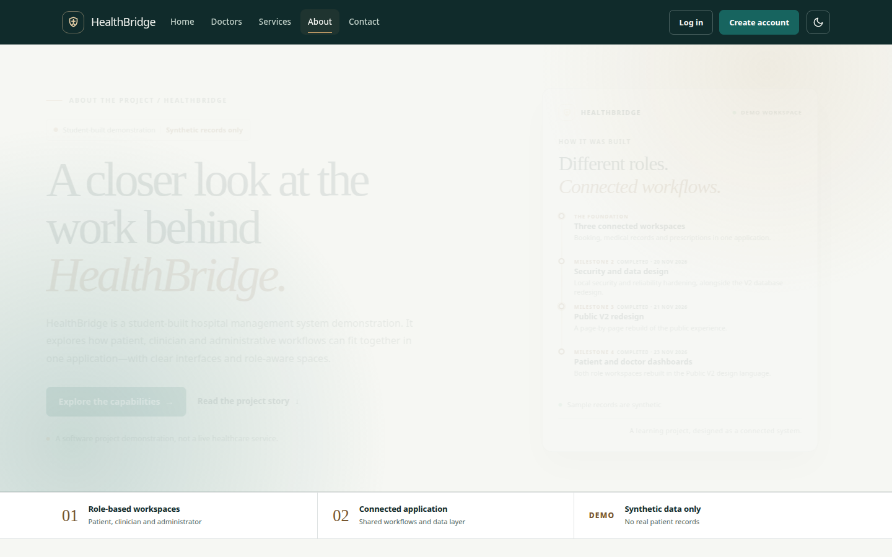
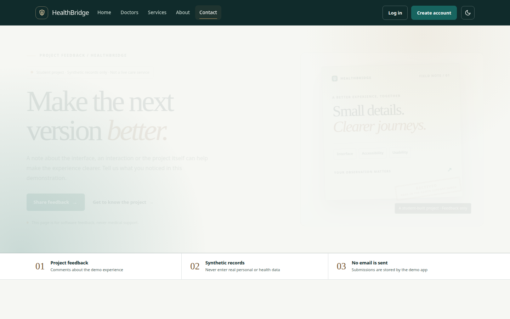
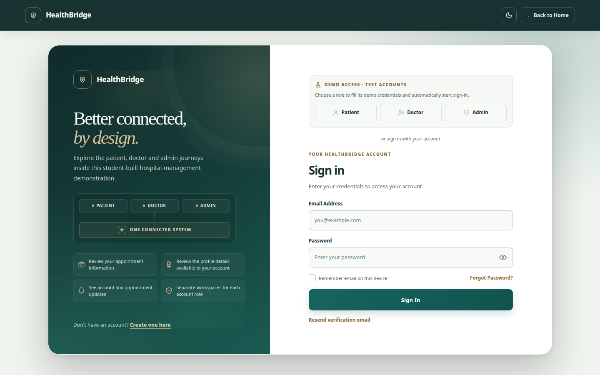
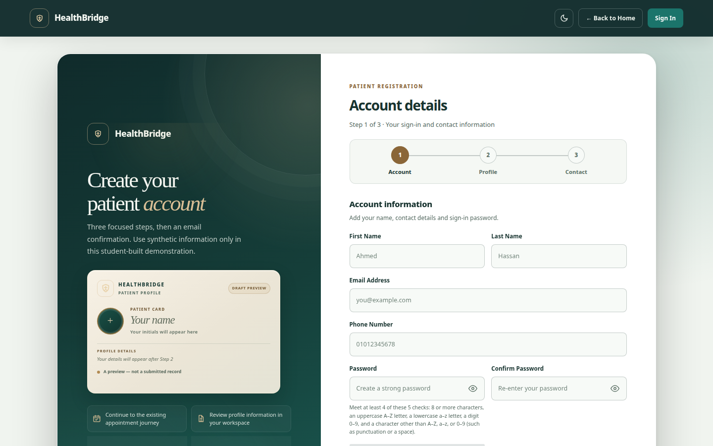
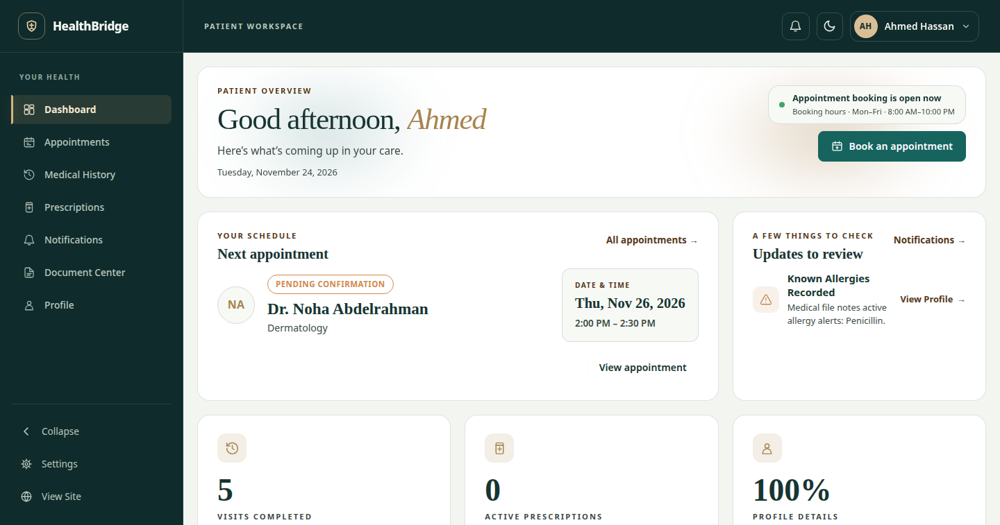
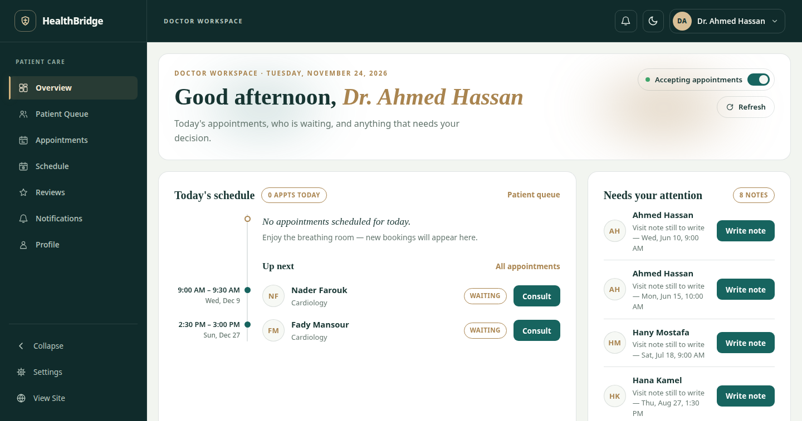
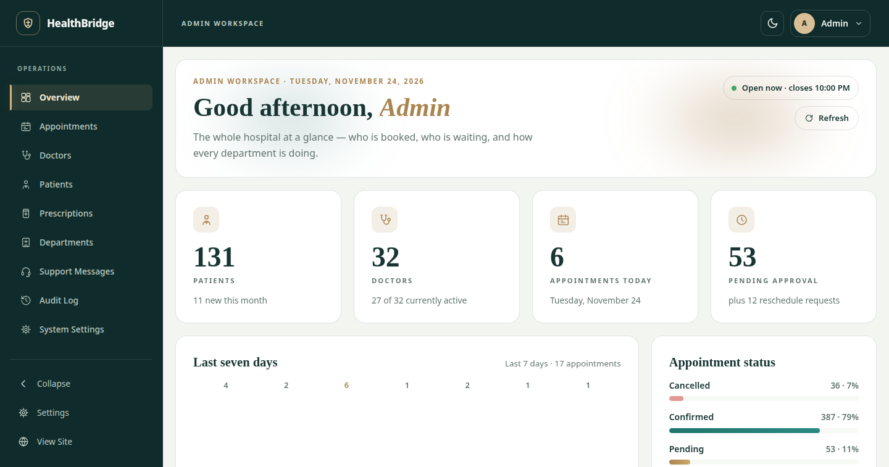

# HealthBridge

A hospital appointment and patient-management web application — public site, online booking, and separate dashboards for patients, doctors and administrators.

**Live demo:** https://youssef1.alwaysdata.net

HealthBridge is a student portfolio project. It is not a production clinical system, and **every record in it — patients, doctors, appointments, prescriptions — is fictional demo data**. Do not use it for real medical information.

## Demo accounts

All three accounts use the password `password`.

| Role    | Email                        | Lands on               |
| ------- | ---------------------------- | ---------------------- |
| Patient | `patient@healthbridge.com`  | Patient dashboard      |
| Doctor  | `ahmed.hassan@healthbridge.com` | Doctor dashboard   |
| Admin   | `admin@healthbridge.com`     | Admin overview         |

You can also register a new patient account on the live demo: registration is email-verified (see below), so use an inbox you can open.

## Features

**Public site** — Home, About, Doctors directory (filterable by department, with individual doctor profiles and ratings), Services and Contact pages, built as a standalone "Public V2" frontend (its own CSS/JS layer in `assets/public-v2/`, loading nothing from the retired V1 frontend).

**Booking** — A multi-step booking wizard for signed-in patients: pick a department and doctor, choose from real available slots generated from the doctor's weekly schedule, and confirm. Appointments can be rescheduled through a request/approve flow with counter-suggestions, and cancelled; every state change notifies the other side.

**Patient dashboard** — Upcoming and past appointments, prescriptions, medical history (EMR view and print), notification centre, downloads, profile and settings, and account deactivation that preserves clinical and audit history.

**Doctor dashboard** — Today's patient queue, appointment management, a clinical workspace for visit notes and encounter workflow, prescription creation (with print), weekly schedule and break management, patient reviews, notifications, profile and settings. Doctors can view and print any patient's prescriptions; only the prescribing doctor can edit, complete or cancel them.

**Admin dashboard** — Overview analytics (hand-built charts, no chart library), doctor and patient management, departments, appointments, a read-only prescription audit view, support-message handling, an audit-log viewer, and hospital/system settings.

**Registration with email verification** — Signing up does not create an account immediately. The request is validated, the password is hashed, and the profile is stored as an encrypted row in a registration-intake queue. A CLI worker processes the queue: it re-checks the email/phone/national ID for duplicates, creates a verification challenge, and emails the confirmation link. The account is created only after the link is confirmed. Registrations whose email, phone number or national ID already belong to an account are refused at submission with a specific message. Sign-in and registration are rate-limited by IP and by submitted identifiers.

**Notifications and email** — In-app notifications are written to an outbox inside the same database transaction as the change that caused them; a second CLI worker delivers them. Transactional email (verification, password reset) is sent over Gmail SMTP.

**Background workers** — Two PHP CLI workers (`tools/process_registration_intake.php` and `tools/process_notification_outbox.php`). In production they run as a single scheduled task every minute:

```bash
php tools/process_registration_intake.php --limit=50 && php tools/process_notification_outbox.php --limit=50
```

## Tech stack

- **Backend:** PHP 8+ (OOP), PDO with prepared statements, MariaDB
- **Frontend:** Vanilla JavaScript (ES6+), modular CSS with design tokens — no framework, no build step
- **Libraries:** Composer only — `vlucas/phpdotenv` (environment config) and `phpmailer/phpmailer` (SMTP)
- **Hosting (live demo):** alwaysdata — PHP 8.4, MariaDB 11.8, one scheduled task running both workers

## Screenshots

| | |
| --- | --- |
|  |  |
| Home | Doctors directory |
|  |  |
| Services | About |
|  |  |
| Contact | Login |
|  |  |
| Register | Patient dashboard |
|  |  |
| Doctor dashboard | Admin overview |

## Local setup

Requirements: PHP 8+ with `pdo_mysql`, `mbstring`, `openssl` and `session` extensions; MariaDB 10.4+ (or MySQL 8+); Composer.

1. Clone the repository and install dependencies:

   ```bash
   git clone https://github.com/youssefmohammed12/hospital-project.git
   cd hospital-project
   composer install
   ```

2. Create a database and import the V2 schema:

   ```bash
   mysql -u root -p -e "CREATE DATABASE healthbridge_v2;"
   mysql -u root -p healthbridge_v2 < database/v2/001_schema.sql
   # then apply the incremental files in order: 002 … 007
   ```

   Note: `database/v2/` also contains the migration and verification tooling used to build this schema from the retired V1 database. Those scripts are fixture-specific QA tools, not a general installer.

3. Configure the environment:

   ```bash
   cp .env.example .env
   ```

   Variables (see `.env.example`): `DB_HOST`, `DB_PORT`, `DB_NAME`, `DB_USER`, `DB_PASS`, `APP_ENV`, `APP_DEBUG`, `APP_BASE_URL` (canonical origin used in email links), and optionally `SMTP_USER` / `SMTP_PASS` for outgoing mail on hosted runtimes. Registration additionally requires `HB_REGISTRATION_QUEUE_KEYS_JSON` (a JSON map of key version → base64-encoded 32-byte key) and `HB_REGISTRATION_QUEUE_ACTIVE_KEY_VERSION`, because queued registration profiles are encrypted at rest.

4. Serve the project root with Apache/Nginx, or PHP's built-in server for a quick look:

   ```bash
   php -S 127.0.0.1:8080 -t .
   ```

   Then open `http://127.0.0.1:8080/`.

5. (For registration and notification delivery) run the workers on a schedule, e.g. cron every minute with the command shown under Features.

The demo accounts listed above exist in the live demo's database; a fresh local schema import starts empty, so register a local account (with the intake worker running) or seed your own users.

## Project structure

```text
index.html, about.html, doctors.html,
services.html, contact.html        Public pages (root)
pages/
  auth/                            Login, register, verify-email, reset-password
  patient/                         Patient dashboard pages
  doctor/                          Doctor dashboard pages
  admin/                           Admin dashboard pages
assets/public-v2/
  css/                             Design tokens, base, components, per-page CSS
  js/core/                         Shared shell, footer loader, helpers
  js/pages/                        Per-page controllers
api/                               JSON endpoints, grouped by domain
                                   (auth, appointments, doctors, medical,
                                   notifications, prescriptions, admin, …)
services/                          OOP business-logic services + Repositories/
includes/                          Bootstrap: DB connection, auth guards,
                                   validation, shared fragments
database/v2/                       V2 schema and migration/QA tooling
tools/                             CLI workers and test/diagnostic scripts
docs/                              Engineering notes and screenshots
```

See [docs/ARCHITECTURE.md](docs/ARCHITECTURE.md) for how the pieces fit together.

## License

No explicit license is included. Please ask the repository owner before reusing or redistributing this code.
