# 🏥 HealthBridge — Hospital Management & Patient Portal Platform

<div align="center">

[](https://www.php.net/)
[](https://www.mysql.com/)
[](https://developer.mozilla.org/en-US/docs/Web/JavaScript)
[](https://developer.mozilla.org/en-US/docs/Web/CSS)
[]()

**A full-stack healthcare management portfolio project with a patient portal, doctor workspace, appointment workflows, electronic medical records, and administrative tools.**

**Project status:** Active repair and refactoring. This is a portfolio/demo project, not a production clinical system or a claim of healthcare regulatory compliance. Demo records are synthetic.

**Engineering scope:** [Portfolio refactor and maintenance plan](docs/HEALTHBRIDGE_PORTFOLIO_REFACTOR_SCOPE.md).

**🌐 Live Demo: https://youssefhealthbridge.freehosting.dev/**

[Key Features](#-key-features) • [Visual Walkthrough](#-visual-walkthrough--feature-showcase) • [Architecture](#-system-architecture) • [Directory Structure](#-directory-structure) • [Installation Guide](#-installation--setup-guide) • [Demo Credentials](#-demo-accounts--quick-login) • [API Reference](#-api-endpoints-overview) • [License](#-license)

</div>

---

## 📖 Overview

**HealthBridge** is a comprehensive, responsive healthcare information system designed to bridge the gap between patients, medical practitioners, and hospital administrators. Built with Vanilla JavaScript (ES6+), modular CSS3, and a PHP 8+ object-oriented backend using PDO, HealthBridge brings together appointment scheduling, clinical encounters, EMR management, multi-step rescheduling workflows, notifications, and audit logging.

---

## 📸 Visual Walkthrough & Feature Showcase

### 1. 🌐 Public Website & Modern Landing Page
The landing page provides patients with instant access to hospital services, top specialist profiles, emergency contact channels, and a 1-click booking entry point.

<div align="center">
  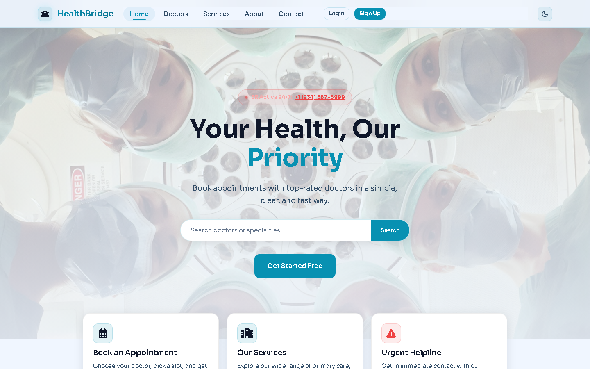
</div>

---

### 2. 🔐 Authentication & Quick-Login Switcher
Secure session-based authentication with instant one-click role switching for evaluation across **Patient**, **Doctor**, and **Administrator** profiles.

<div align="center">
  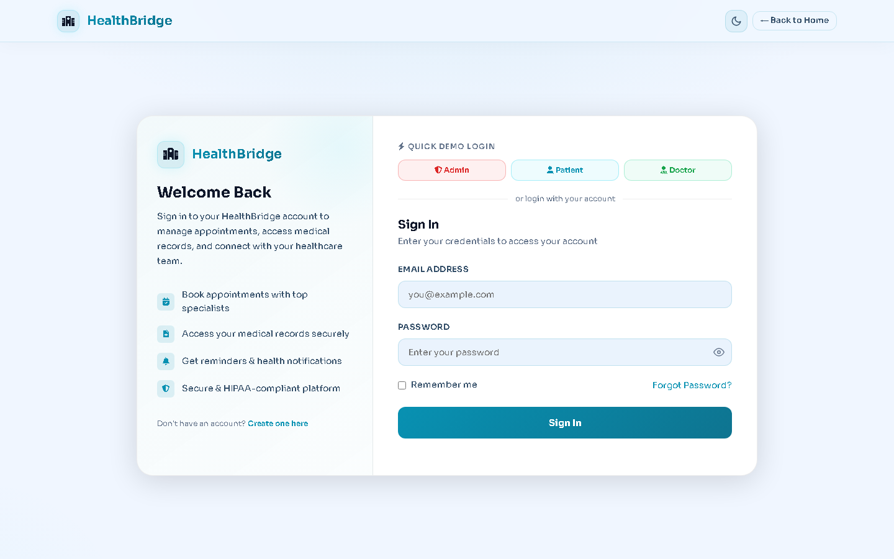
</div>

---

### 3. 👤 Patient Portal & Smart Booking Wizard
Patients can track their upcoming appointments, active prescriptions, recent vitals, and book appointments via a 4-step wizard with real-time doctor availability checks.

<div align="center">
  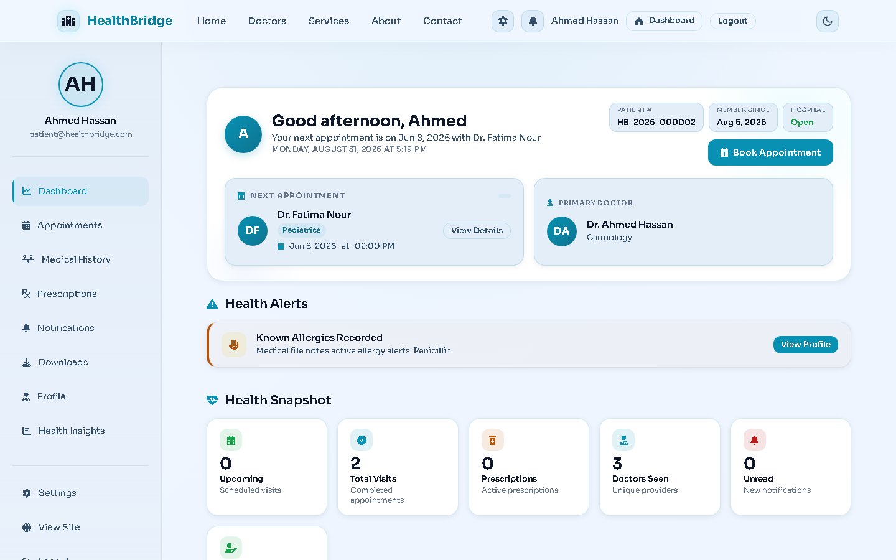
  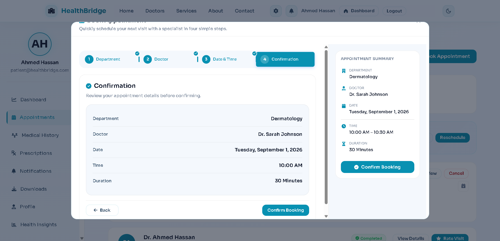
</div>

---

### 4. 📅 Appointment Rescheduling & Medical Records (EMR)
Patients can manage visits, request date/time reschedules with conflict detection, review detailed diagnosis history, and download printable prescription summaries.

<div align="center">
  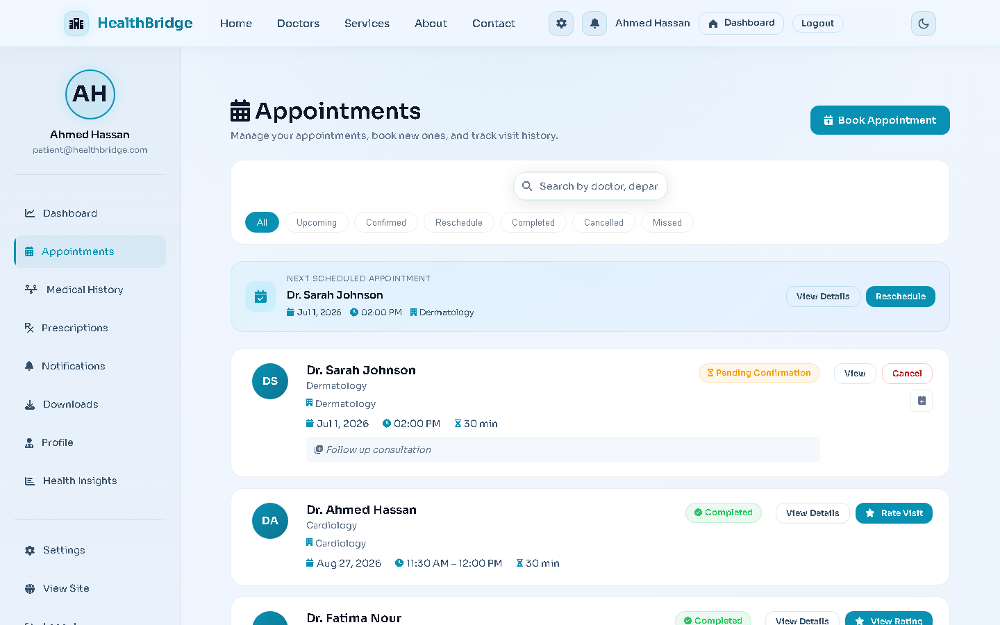
  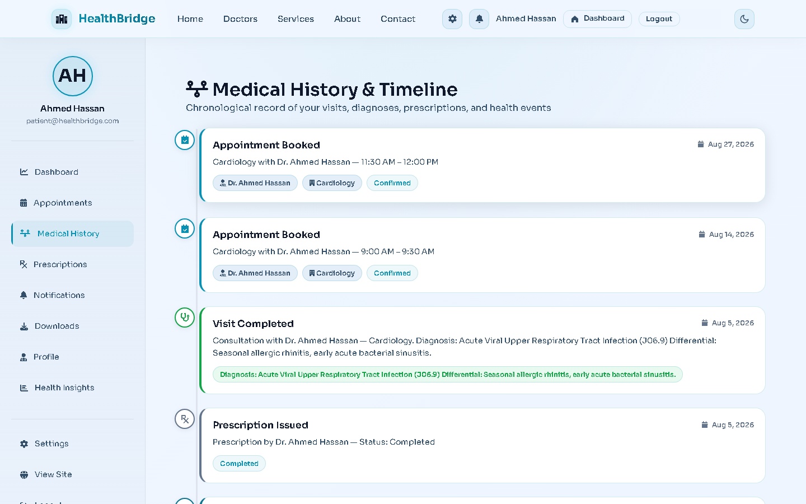
</div>

---

### 5. 🩺 Doctor Workspace & Clinical Encounters
Doctors have access to a real-time patient queue, schedule management, 1-click reschedule approvals/counter-suggestions, and an integrated clinical encounter studio for SOAP notes and digital prescriptions.

<div align="center">
  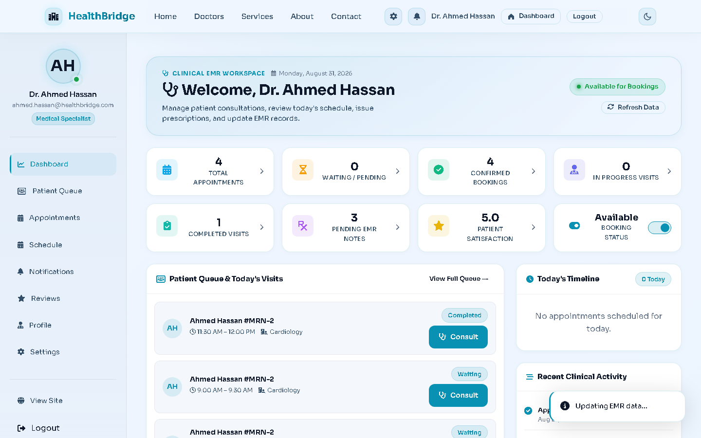
  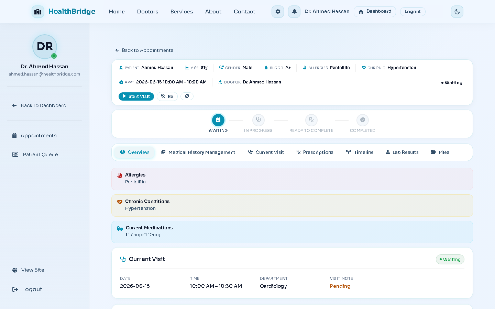
</div>

---

### 6. 🛡️ Administrative Control & Staff Directory
Hospital administrators monitor real-time hospital KPIs (patient traffic, revenue estimates, department load), manage medical staff accounts, and configure clinic departments.

<div align="center">
  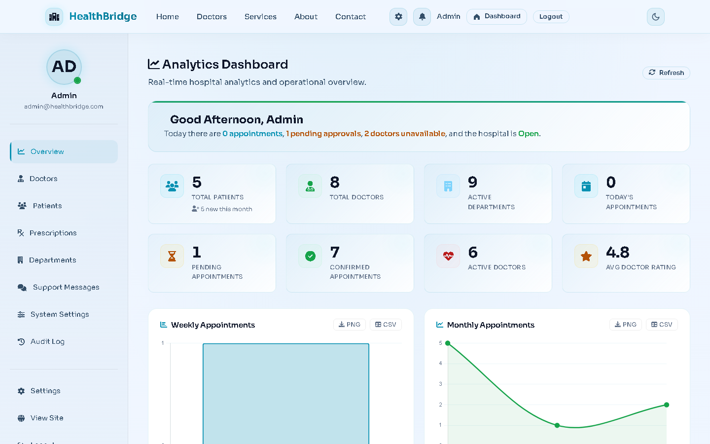
  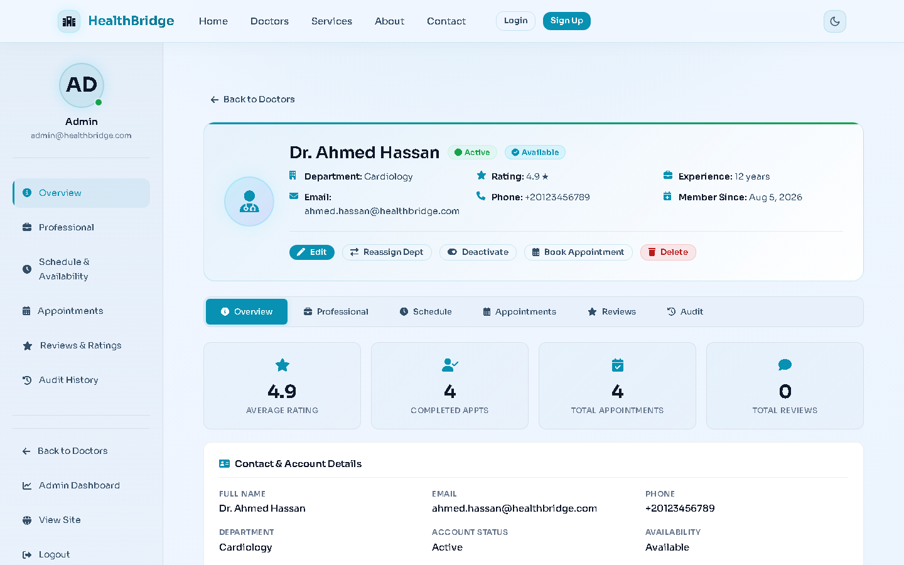
</div>

---

## 🌟 Key Features

### 👤 1. Patient Portal
* **Health Dashboard & Snapshot**: Real-time vital metrics, upcoming visits, active prescriptions, and recent clinical notes.
* **Interactive Booking Wizard**: 4-step smart appointment booking with real-time doctor availability checks and dynamic time-slot generation.
* **Reschedule Workflow**: Request appointment rescheduling with real-time slot validation, doctor negotiation, and instant approval/rejection handling.
* **Electronic Medical Records (EMR)**: Complete access to personal diagnosis history, visit summaries, lab reports, and doctor notes.
* **Prescription Manager**: Active/completed medication tracker with dosage schedules, instructions, and 1-click printable Rx summaries.
* **Notification Center**: Real-time alert feed with categorized badge counts and unread state management.
* **Settings & Preferences**: Personal profile management, notification settings, security controls, and account deactivation that retains medical and audit history.

### 🩺 2. Doctor Workspace
* **Real-time Queue & Schedule**: Filter today''s appointments by status (`Confirmed`, `In-Progress`, `Completed`, `Reschedule Requested`).
* **Clinical Encounters & Notes**: Draft, review, and finalize visit notes with subjective, objective, assessment, and plan (SOAP) support.
* **Reschedule Negotiation**: 1-click **Approve**, **Reject**, or **Suggest Alternative Time** for patient reschedule requests.
* **Digital Prescription Studio**: Fast medication lookup, dosage specifications, frequency presets, and PDF/printable generation.
* **Doctor Availability Controls**: Weekly schedule manager, slot interval configuration, break-time definitions, and on-leave toggles.
* **Doctor Ratings & Reviews**: Public and internal rating analytics with patient feedback tracking.

### 🛡️ 3. Administrative Control Center
* **Hospital Analytics Dashboard**: Live metrics for patient volume, revenue estimation, department load, and appointment completion rates.
* **Staff & Doctor Directory**: Register, edit, activate/deactivate medical staff, and assign specialists to hospital departments.
* **Department Management**: Create, update, and manage specialty departments (Cardiology, Dermatology, Pediatrics, etc.).
* **Comprehensive Audit Trail**: Records authentication events, clinical edits, appointment changes, and administrative actions. Database retention safeguards prevent routine account/appointment deletion from cascading into clinical and audit history; a cryptographic tamper-evident chain is not currently implemented.
* **Hospital Settings & Messaging**: Manage clinic metadata, working hours, contact info, and patient inquiry responses.

---

## 🏗️ System Architecture

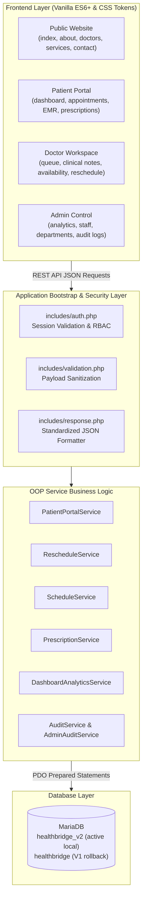

---

## 📁 Directory Structure

```text
healthbridge/
├── api/                             # RESTful JSON Endpoints
│   ├── admin/                       # Admin analytics & system operations
│   ├── appointments/                # Booking, slot picking, rescheduling API
│   ├── audit/                       # Audit logging endpoints
│   ├── auth/                        # Login, registration, password recovery
│   ├── departments/                 # Department CRUD & doctor assignments
│   ├── doctors/                     # Doctor profiles, schedules & ratings
│   ├── medical/                     # Clinical notes, EMR, visit drafts
│   ├── notifications/               # Notification feeds & status updates
│   ├── patient/                     # Patient dashboard aggregated data
│   ├── patients/                    # Patient directory management
│   ├── prescriptions/               # Prescription creation & print views
│   ├── schedule/                    # Doctor schedule configuration
│   └── settings/                    # Hospital profile & contact messages
│
├── assets/                          # Static Frontend Assets
│   ├── css/
│   │   ├── base/                    # Reset, typography, design tokens
│   │   ├── components/              # Buttons, cards, modals, tables, badges
│   │   ├── modules/                 # EMR, schedule, prescription styling
│   │   └── pages/                   # Page-specific stylesheets
│   └── js/
│       ├── components/              # Booking wizard, layout injector
│       ├── core/                    # Auth manager, global utilities, main.js
│       ├── modules/                 # Prescriptions, notifications, schedule
│       └── pages/                   # Page controllers (admin, doctor, patient)
│
├── database/                        # Active V2 schema and validation assets
│   ├── .htaccess                    # Denies direct web access
│   └── v2/                          # V2 schema, migrations, compatibility and QA tools
├── docs/
│   └── screenshots/                 # High-resolution application screenshots
│
├── includes/                        # Core Backend Framework Bootstrap
│   ├── auth.php                     # Session management & role-based auth
│   ├── db.php                       # PDO connection with .env & fallback
│   ├── helpers.php                  # Date formatting, sanitization helpers
│   ├── permissions.php              # Access control list (ACL) rules
│   ├── response.php                 # Unified JSON response helper
│   ├── validation.php               # Form & input validators
│   └── fragments/                   # Reusable HTML layout fragments (navbar, sidebar)
│
├── pages/                           # Role-Based Page Templates
│   ├── admin/                       # admin.html, admin-doctor-profile.html
│   ├── auth/                        # login.html, register.html, reset-password.html
│   ├── doctor/                      # doctor-dashboard.html, doctor-workspace.html
│   └── patient/                     # dashboard.html, appointments.html, prescriptions.html, etc.
│
├── services/                        # PHP OOP Service Classes (Business Logic)
├── tools/                           # CLI Test & Diagnostics Verification Scripts
├── .env.example                     # Environment configuration template
├── .gitignore                       # Git ignore rules (vendor, logs, env, caches)
├── composer.json                    # Composer dependencies (phpdotenv)
├── index.html                       # Public landing page
├── about.html                       # Hospital about page
├── contact.html                     # Contact and inquiry page
├── doctors.html                     # Public doctors directory
├── services.html                    # Public medical specialties list
└── README.md                        # Documentation
```

---

## 🚀 Installation & Setup Guide

### Prerequisites
- **Web Server**: Apache / Nginx / XAMPP / WampServer / LAMP stack
- **PHP**: Version 8.0 or higher with `pdo_mysql`, `mbstring`, `json`, and `session` extensions enabled
- **Database**: MySQL 8.0+ or MariaDB 10.4+
- **Composer**: (Optional) for managing PHP dependencies

---

### Step 1: Clone the Repository
Clone the project into your web server''s root directory (`htdocs` or `/var/www/html/`):

```bash
git clone https://github.com/youssefmohammed12/hospital-project.git healthbridge
```

---

### Step 2: Database and runtime status

**Local XAMPP/Apache is now running on V2.** The ordinary local website at http://127.0.0.1/optimized/ connects to the canonical MariaDB database healthbridge_v2. Its source data was migrated from the preserved local V1 database healthbridge; the V2 database passed the local table, foreign-key, backup/restore, service-read and HTTP smoke checks recorded in docs/HEALTHBRIDGE_LOCAL_V2_CUTOVER_20261120.md.

The original V1 database healthbridge remains intact as the rollback source. The former V1 fresh-install SQL files, Phase 10?17 migration bundle, archived migration SQL and V1-only CLI migration/demo PHP helpers have been moved to a local migration archive outside the repository and web root. That archive includes a README and SHA-256 manifest. Those files are retained for historical reference only; do not execute them against the active V2 database. Their former paths under database/ and tools/ are no longer active.

The current database/v2/ folder contains the V2 schema and its migration/validation tools. Some of those runners are fixture-specific QA tools, not a generic fresh-install installer. Do not import 001_schema.sql into an existing database or run prototype/ETL scripts against healthbridge_v2. A clean fresh-install/recovery procedure for V2 requires its own separately verified backup/restore and migration plan.

The local Apache V2 override is stored in the local project-root .htaccess and is intentionally excluded from version control; it must never be deployed to the hosted environment. The .env file was not changed for cutover; the actual CLI runtime still selects V1, and the registration worker entrypoint explicitly uses SCHEMA_V1. Both local scheduled worker tasks are currently disabled pending V2-specific worker entrypoints/configuration and separately approved mail-delivery validation. Do not re-enable them yet. The canonical V2 admin/doctor/patient login, authorization and logout/session-invalidation matrix passed on 20 November 2026. Milestone 3 is now in progress and its M3.0 page/source, responsive, accessibility and performance baseline is complete. The technology decision is to retain the PHP-rendered application and vanilla JS/CSS, progressively modularizing only where justified; no frontend framework or new dependency is being added. See `docs/HEALTHBRIDGE_MILESTONE_3_PLAN.md`, `docs/HEALTHBRIDGE_MILESTONE_3_AUDIT_20261120.md`, `docs/HEALTHBRIDGE_MILESTONE_3_UX_ARCHITECTURE_20261120.md` and `docs/HEALTHBRIDGE_MILESTONE_3_VISUAL_SYSTEM_20261120.md`. The first three isolated Patient Dashboard, Doctor Dashboard and Admin Overview prototypes and their evidence are stored in a local migration-backups folder outside the web root. This is not production/deployment approval and hosted P0*/P1 gates remain open. See docs/HEALTHBRIDGE_ROLE_LOGIN_AND_WORKER_READINESS_20261120.md.

For the full migration provenance, selected row counts, verification results, rollback instructions and open gates, read docs/HEALTHBRIDGE_LOCAL_V2_CUTOVER_20261120.md.

**Local database cleanup (20 November 2026):** Fourteen unused HealthBridge QA/ETL/restore schemas were first exported, SHA-256 verified, then dropped. Their complete SQL dumps, manifests and restore instructions remain in a local database-retirement backup folder outside the web root. A restored V2 dump passed 37/37 `CHECK TABLE` checks. The online database set now comprises `healthbridge` (V1 rollback), `healthbridge_v2` (active local website), and four retained QA fixtures referenced by current tools. No other project or hosted databases were touched.
### Step 3: Environment Configuration (Optional)

HealthBridge works out of the box with standard local development defaults (`127.0.0.1`, user `root`, empty password). For custom setups:

1. Copy the sample environment file:
   ```bash
   cp .env.example .env
   ```
2. Edit `.env` with your database credentials:
   ```ini
   DB_HOST=127.0.0.1
   DB_PORT=3306
   DB_NAME=healthbridge
   DB_USER=root
   DB_PASS=your_secure_password
   ```

---

### Step 4: Launch & Access

Open your web browser and navigate to:
```text
http://localhost/healthbridge/
```

---

## 🔑 Demo Accounts & Quick Login

The application provides demo accounts pre-configured for evaluation. You can also use the **Quick Login** buttons on the login screen to switch between roles instantly:

| Role | Email | Password | Access Area |
| :--- | :--- | :--- | :--- |
| **Administrator** | `admin@healthbridge.com` | `password` | `/pages/admin/admin.html` |
| **Doctor** | `ahmed.hassan@healthbridge.com` | `password` | `/pages/doctor/doctor-dashboard.html` |
| **Patient** | `patient@healthbridge.com` | `password` | `/pages/patient/dashboard.html` |

---

All 10 original demo accounts (the administrator, patient, and eight doctors) retain the shared demo password `password`. Three additional original patient accounts are also present.

The expanded local seed adds:
- Patients: `patient001@demo.healthbridge.test` through `patient120@demo.healthbridge.test`
- Doctors: `doctor001@demo.healthbridge.test` through `doctor024@demo.healthbridge.test`
- Password for these synthetic accounts: `password`

All generated profiles and clinical entries are fictional software-demo data, not real patients, medical histories, or prescriptions. Do not use them for clinical decisions.

---

## 📡 API Endpoints Overview

HealthBridge APIs return JSON with a `success` flag and endpoint-specific fields at the top level. The payload shape varies by endpoint; fields are **not** universally nested under `data`. For example, an appointments response may contain `success`, `appointments`, and `total` as sibling fields.

| Category | Endpoint | Method | Description |
| :--- | :--- | :--- | :--- |
| **Auth** | `/api/auth/login.php` | `POST` | Authenticate user & start session |
| **Auth** | `/api/auth/logout.php` | `POST` | Destroy session & logout |
| **Auth** | `/api/auth/current_user.php` | `GET` | Get authenticated user info |
| **Appointments** | `/api/appointments/get-available-slots.php` | `POST` | Calculate available doctor slots from JSON input |
| **Appointments** | `/api/appointments/book.php` | `POST` | Book a new patient appointment |
| **Appointments** | `/api/appointments/request-reschedule.php` | `POST` | Patient requests new time slot |
| **Appointments** | `/api/appointments/approve-reschedule.php` | `POST` | Doctor confirms reschedule request |
| **Appointments** | `/api/appointments/suggest-reschedule.php` | `POST` | Doctor proposes alternate slot |
| **Medical** | `/api/medical/get-emr-data.php` | `GET` | Load full patient EMR record |
| **Medical** | `/api/medical/save-visit-draft.php` | `POST` | Auto-save clinical visit draft |
| **Prescriptions** | `/api/prescriptions/create.php` | `POST` | Issue prescription with medications |
| **Admin** | `/api/admin/dashboard-analytics.php` | `GET` | Fetch hospital KPIs & metrics |
| **Audit** | `/api/audit/get.php` | `GET` | Retrieve filtered system audit trail |

---

## 🧪 Developer CLI Verification & Tests

The shared testing toolkit at D:\dev-toolkit is the primary runner for new HealthBridge unit tests, Chromium browser E2E, axe accessibility, mobile accessibility and Lighthouse audits. Read docs/HEALTHBRIDGE_TESTING_TOOLKIT.md before adding tests. Keep test specs in D:\dev-toolkit\tests\unit\healthbridge and D:\dev-toolkit\tests\e2e\healthbridge; do not add duplicate test packages to this application. Generic toolkit self-checks are not HealthBridge workflow acceptance.

Run the Patient Portal service diagnostics only against a disposable local test database. In PowerShell, set the local test connection and explicit opt-in first:

```powershell
$env:DB_HOST = "127.0.0.1"
$env:DB_PORT = "3306"
$env:DB_NAME = "healthbridge_repair_test"
$env:DB_USER = "root"
$env:DB_PASS = ""
$env:HB_ALLOW_LOCAL_DB_DIAGNOSTICS = "1"
php tools/test_dashboard_api.php
```

The script refuses to connect unless the opt-in is set, the DB host is loopback, and the database name ends in `_test` or `_qa`. The previous `verify_patient_portal.php` structural verifier was removed because it targeted an obsolete dashboard implementation and produced misleading failures against the current UI. Add current behavior-based browser/API tests in the shared toolkit's HealthBridge test folders instead of creating another ad-hoc structural verifier.

---

## 🔒 Security Architecture

- **Database Access**: API and service database operations should use PDO prepared statements and parameter binding; continue auditing legacy query paths.
- **Role-Based Access Control (RBAC)**: Protected endpoints use shared authentication/role guards, with resource ownership checks for patient and doctor data.
- **Input Validation**: Request validation and sanitization are centralized in `includes/validation.php` and applied at API boundaries.
- **Session Protection**: Session IDs rotate at login; cookies use HttpOnly and SameSite=Lax, Secure on HTTPS, with 30-minute idle and 8-hour absolute timeouts. Protected requests recheck account status and role.
- **Request Origin**: Browser API requests use a same-origin policy; wildcard CORS is not enabled.
- **Authentication Abuse Controls**: Public registration and sign-in are throttled by source IP and HMACs of submitted identifiers using a host-local lock file under the system temporary directory, outside the document root. Registration limits are step-specific (20/IP/10 min and 5/identifier/hour for step 1; 10/IP/hour and 3/identifier/hour for step 2); login allows 10 attempts/email and 60/IP per 15 min. The limiter trusts `REMOTE_ADDR` only; deployments behind a reverse proxy must configure a trusted client-IP strategy. Multi-host deployments must replace the local file store with shared Redis/database storage.
- **Audit Logging**: Critical clinical, administrative, and appointment actions are recorded in audit services; transactional consistency and retention policies remain subject to ongoing review.

---

## 📄 License

No explicit project license is currently included. Obtain permission from the repository owner before reusing or redistributing this project.

<div align="center">

Made with ❤️ for modern, accessible healthcare management.

</div>

## Notification delivery reliability

Runtime notification producers enqueue events into notification_outbox within their owning business transactions. Reviewed coverage includes appointment lifecycle, all seven reschedule transitions, prescription mutations, clinical visit completion and updates, patient/doctor account lifecycle and creation, patient profile/password updates, ratings, settings profile/deactivation, and support replies. The reviewed route coverage and test evidence are summarized in `docs/HEALTHBRIDGE_QA_EVIDENCE_INDEX.md` and `docs/HEALTHBRIDGE_FINDINGS_REGISTER.md`.

The CLI worker entrypoint is tools/process_notification_outbox.php and the PowerShell wrapper is tools/run_notification_outbox_worker.ps1. The Windows Scheduled Task was configured for a five-minute repetition under the configured local Windows account, but it is currently Disabled. The CLI runtime selects healthbridge (V1), and this worker does not assert a V2 database target. Do not run the worker manually or re-enable its schedule until V2-specific target/schema guards and retry/retention behavior are accepted. See docs/HEALTHBRIDGE_ROLE_LOGIN_AND_WORKER_READINESS_20261120.md.

Historical automatic task runs observed before the pause returned exit code 0 with zero delivered, skipped, retried, terminal-failed, or pending events. This is not proof of end-to-end delivery under load. The worker also performs a 30-day retention delete of delivered/skipped rows; the effect of those historical automatic runs was not separately fingerprinted. No external alerting is configured. Never expose outbox payloads or personal/clinical information in operational logs.
